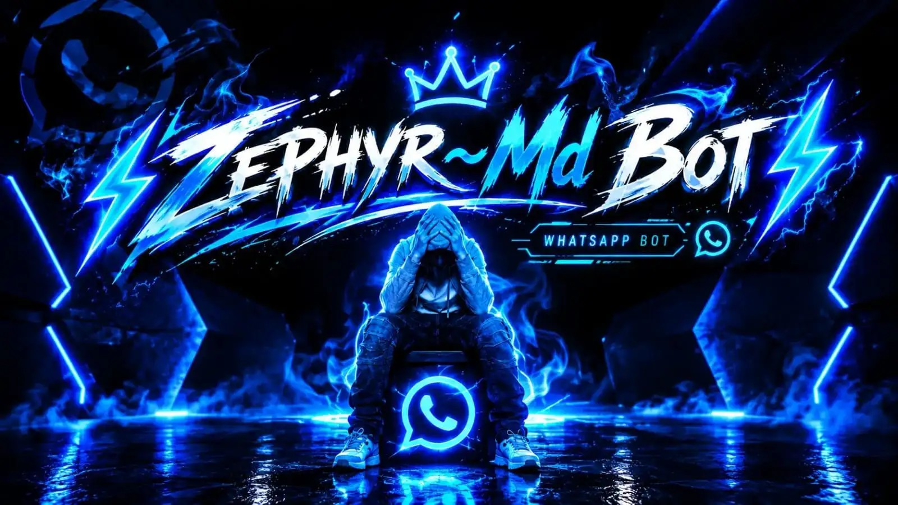

<div align="center">



<br><br>


<br>

**A cinematic multi-device WhatsApp engine.**  
Named sessions. Live companion codes. One-message menus. Always on.

<br><br>

<a href="https://zephyrmdbot.onrender.com/"></a>
&nbsp;
<a href="https://zephyr-md-pair3.onrender.com/"></a>
&nbsp;
<a href="https://wa.me/27621834910"></a>

<br><br>


<br><br>

[Channel](https://whatsapp.com/channel/0029Vb8p6DV8aKvNTp6n8n45)
&nbsp;·&nbsp;
[GitHub](https://github.com/Samkelo119/zephyrmdbot)
&nbsp;·&nbsp;
[Admin](https://zephyrmdbot.onrender.com/admin)

</div>

---

<p align="center">
  
  
  
</p>

```text
┌──────────────────────────────────────────────────────────┐
│  ZEPHYR MD PAIRING                                       │
│  1. Open  https://zephyrmdbot.onrender.com               │
│  2. Write your session name                              │
│  3. Enter number with country code                       │
│  4. Generate  →  live 8-character WhatsApp code          │
│  5. Linked Devices  →  Link with phone number            │
└──────────────────────────────────────────────────────────┘
```

---

## Signature

ZEPHYR MD is not a throwaway script dump. It is a branded multi-device runtime:

| Pillar | What you get |
| :--- | :--- |
| Named pairing | Every user writes a session name before a code is issued |
| Isolated sessions | Extra numbers land in `user_<number>`, never overwrite owner |
| Always on | 10s watchdog reconnects every registered session |
| One-message menu | Picture + full command list together, 17 fonts |
| Per-user style | Prefix and menu font apply only to the requester |
| Live admin | Feature toggles and API keys apply immediately |

Owner lock stays on **27621834910**. Footer everywhere: **Powered By MrDieHardTechX**.

---

## Pair in 60 seconds

1. Open [zephyrmdbot.onrender.com](https://zephyrmdbot.onrender.com/)
2. Write a session name first
3. Enter WhatsApp number with country code, no `+`
4. Tap **Generate Code**
5. Phone: **Linked Devices → Link with phone number**
6. Enter the live 8-character code within about one minute

Backup console: [zephyr-md-pair3.onrender.com](https://zephyr-md-pair3.onrender.com/)

Owner command:

```text
.pair 27621834910 SessionName
```

---

## Quick Start

```bash
git clone https://github.com/Samkelo119/zephyrmdbot.git
cd zephyrmdbot
node bootstrap.js
```

`bootstrap.js` installs dependencies on first run, then starts the bot on port **3000**.

```bash
npm install
node index.js
```

Persistent Node is required. Serverless hosts cannot keep the WhatsApp socket open.

---

## Command Atlas

Type `.menu` in WhatsApp for the live list with your prefix, font, and banner.

| Suite | Commands |
| :--- | :--- |
| Core | `menu` `help` `alive` `ping` `owner` `runtime` `uptime` `mode` `time` `clock` `jid` `about` `botinfo` |
| Owner | `public` `private` `mode` `setname` `setprefix` `hack` `pair` |
| Styles | `menustyle` `menustyle1` … `menustyle17` |
| Media | `song` `play` `video` `tiktok` `insta` `facebook` `apk` `ytdown` `crunchyroll` |
| Stickers | `sticker` `s` `toimg` `take` `telesticker` `tts` |
| Group | `kick` `promote` `demote` `hidetag` `tagall` `welcome` `grouplink` |
| Guard | `mute` `warn` `filter` `slowmode` `antilink` `antidelete` `anticall` |
| AI | `ai` `gpt` `openai` `chatgpt` `metaai` |
| Extra | `repo` `update` `support` `channel` |

`.update` is public. It pulls `origin/main` and restarts so every paired bot receives the same release.

---

## Environment

| Variable | Purpose | Default |
| :--- | :--- | :--- |
| `OWNER_NUMBER` | Owner WhatsApp, no `+` | `27621834910` |
| `PORT` | Pairing / admin port | `3000` |
| `ADMIN_PANEL_PASSWORD` | `/admin` login | `samkelonzimandesmall` |
| `OPENAI_API_KEY` | Optional AI key | unset |

Never commit `auth_info/`, `data/`, or `.env`. Set `openaiApiKey` in `/admin` after deploy.

---

## Architecture

```text
zephyrmdbot/
├── bootstrap.js          crash-safe launcher
├── index.js              pairing, sessions, command router
├── pair.html             luxury pairing console
├── settings.js           brand, owner, timezone
├── commands/             command modules
├── lib/                  menu, styles, admin, AI helper
├── admin-panel/          live control room
├── assets/menu.jpg       banner used by menu, pair, README
├── auth_info/            WhatsApp sessions  (gitignored)
└── data/                 runtime state     (gitignored)
```

Timezone: **Africa/Johannesburg**. Sticker pack: **ZEPHYR MD**.

---

## Deploy

See `DEPLOY.md` for Railway, Replit, Heroku, Termux, and VPS.

```bash
pm2 start bootstrap.js --name zephyrmd-bot
```

---

<div align="center">

### House of ZEPHYR

| | |
| :--- | :--- |
| Bot | **ZEPHYR MD** |
| Owner | **MrDieHardTechX** |
| Number | [27621834910](https://wa.me/27621834910) |
| Channel | [whatsapp.com/channel/0029Vb8p6DV8aKvNTp6n8n45](https://whatsapp.com/channel/0029Vb8p6DV8aKvNTp6n8n45) |
| Repo | [Samkelo119/zephyrmdbot](https://github.com/Samkelo119/zephyrmdbot) |

<br>

**Powered By MrDieHardTechX**

<br>

<a href="https://zephyrmdbot.onrender.com/"></a>

<br><br>


</div>
